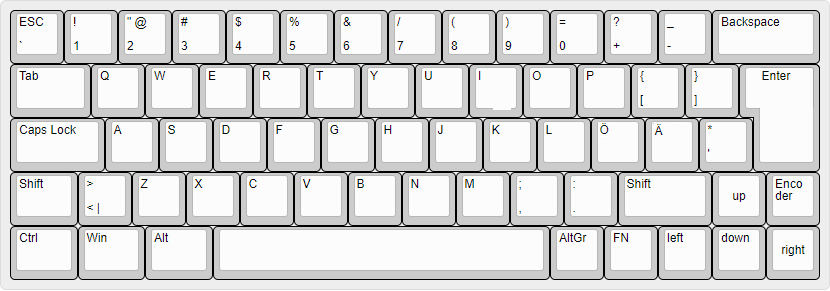

# Teemu's BT60 layout (ZMK)

My personal [ZMK](https://zmk.dev) firmware config for the **Polarity Works BT60 v2**
(nRF52840, Bluetooth + USB) with an ISO layout, a rotary encoder in the bottom-right
cluster and arrow keys. The keymap is written for a **Finnish/Nordic ISO** OS layout
(e.g. `SEMI` gives Ö, `SQT` gives Ä).



*Base layer. The image dates from 2022, but the key positions still match the current
base layer.*

## Files

| File | What it is |
|------|------------|
| `config/bt60.keymap` | The keymap (two layers + encoder bindings) |
| `config/boards/arm/bt60/` | Board definition (matrix transform, encoders, backlight, RGB) |
| `config/west.yml` | Pins the ZMK version the build uses |
| `.github/workflows/build.yml` | GitHub Actions build that produces `bt60.uf2` |
| `rowcolmap.png` | Row/column wiring diagram from the upstream repo |

## Layers

### 0: Base

```
| Esc | 1 | 2 | 3 | 4 | 5 | 6 | 7 | 8 | 9 | 0 | + | - | Bksp |
| Tab  | Q | W | E | R | T | Y | U | I | O | P | Å | ¨ |  Enter
| Caps  | A | S | D | F | G | H | J | K | L | Ö | Ä | ' |  (ISO)
| Shift | < | Z | X | C | V | B | N | M | , | . | Shift | Up | Knob |
| Ctrl | Win | Alt |          Space          | AltGr | Fn | Left | Down | Right |
```

- The key right of `0` sends `MINUS` (`+` on a Finnish layout) and the next one sends
  `FSLH` (`-` on a Finnish layout).
- `<` left of Z is `NON_US_BSLH`; the key left of Enter is `NON_US_HASH` (`'` / `*`).
- **Fn** is momentary layer 1 (`&mo 1`).

### 1: Fn (hold Fn)

| Key | Fn + key |
|-----|----------|
| 1 … 0, +, - | F1 … F12 |
| Backspace | Delete |
| Tab | Clear current Bluetooth profile |
| Q, E, R, T, Y | Bluetooth profile 1, 2, 3, 4, 5 |
| W / A S D | Arrow keys (Up / Left Down Right) |
| I | Insert |
| P, Å, ¨ | Print Screen, Scroll Lock, Pause |
| Ö / Ä | Home / Page Up |
| Enter | **Bootloader** (for flashing) |
| < | Previous track |
| Z / X / C | Volume down / up / mute |
| V / B | Backlight brighter / dimmer |
| N / M | RGB saturation down / up |
| , / . | RGB effect / RGB on-off |
| Right Shift | End |
| Up / Down | Page Up / Page Down |
| Knob press | Backlight on-off |
| Win | Next Bluetooth profile |
| Space | **Reset** the keyboard (`&sys_reset`) |
| AltGr | Toggle output USB / Bluetooth |
| Right arrow | Clear current Bluetooth profile |

## Encoder

- **Turn:** volume up / down (on both layers).
- **Press:** Play/Pause; Fn + press toggles the backlight.
- Two encoder positions are enabled in the board file (`encoder_1` on P0.21/P0.19 and
  `encoder_2` on P0.26/P0.06), and both get the same volume bindings, so the knob works
  whichever encoder footprint it is soldered to.

## Build

The firmware builds on GitHub Actions on every push (or run it by hand from
**Actions → Build → Run workflow**):

1. Edit `config/bt60.keymap` and commit/push.
2. Open the **Actions** tab and wait for the run to finish (green tick).
3. Download the **firmware** artifact from the run's summary page. It contains `bt60.uf2`.

The build is pinned to ZMK commit `94789a0` (May 2023, Zephyr 3.2) in `config/west.yml`
and the `zmkfirmware/zmk-build-arm:3.2` container. Newer ZMK (newer Zephyr and the
hardware model v2 board layout) does not build this board definition without porting
it, so don't move `revision:` back to `main` unless you port the board files as well.

## Flash

1. Connect the keyboard over USB.
2. Enter the bootloader with **Fn + Enter** (or double-tap the reset button on the PCB).
   A USB drive appears.
3. Copy `bt60.uf2` onto that drive. The keyboard reboots by itself once it has the file.

## Credits

Based on [PolarityWorks/zmk-config-ckp](https://github.com/PolarityWorks/zmk-config-ckp),
the official Polarity Works ZMK config for the BT60/CKP boards (board definition,
wiring diagram and build workflow come from there). The stock upstream version of this
repo is kept on the `upstream-main` branch.
